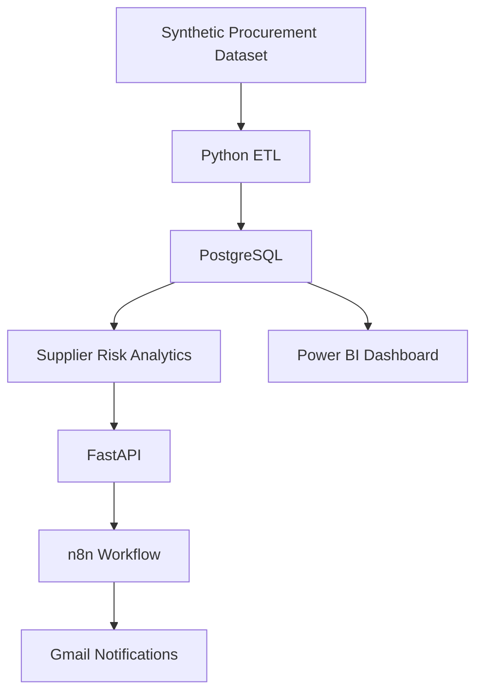

# Supplier Intelligence & Early Warning System

An end-to-end supplier risk monitoring and early warning platform built with Python, PostgreSQL, FastAPI, n8n, and Power BI.

The system analyzes procurement data, evaluates supplier risk, exposes risk alerts through a secure API, and automates notifications through n8n.

> **Note:** This portfolio project uses synthetic procurement data. It does not contain actual company or supplier records.

## Project Overview

Supplier performance and procurement risks can affect operational continuity, product quality, and purchasing costs.

This project demonstrates how procurement data can be transformed into actionable supplier intelligence through data engineering, risk analytics, API development, and workflow automation.

### Key Capabilities

- Procurement data processing and cleaning
- Automated data quality validation
- Supplier risk scoring and classification
- PostgreSQL-based analytics
- Secure REST API with API key authentication
- Automated supplier risk notifications
- Power BI dashboard integration (in progress)

## System Architecture



## Technology Stack

| Layer | Technologies |
|---|---|
| Data Processing | Python, Pandas |
| Database | PostgreSQL |
| Backend | FastAPI, Python |
| API Security | API Key Authentication |
| Workflow Automation | n8n |
| Notifications | Gmail |
| Business Intelligence | Power BI, DAX |
| Containerization | Docker |
| Cloud Database | Supabase |
| API Hosting | Render |
| Version Control | Git, GitHub |

## Data Engineering & Quality

The project uses a synthetic procurement dataset containing 777 purchase orders and 11 original columns.

The data processing pipeline includes:

- Missing-value analysis
- Data type validation
- Duplicate record checks
- Delivery date consistency checks
- Procurement data cleaning
- Data quality classification

Records are categorized into:

- `VALID`
- `REVIEW_REQUIRED`

The project preserves raw procurement data separately from processed data to support data traceability.

## Supplier Risk Analytics

The analytics layer evaluates suppliers using multiple risk dimensions:

- Compliance Risk
- Defect Risk
- Operational Risk
- Data Quality Risk

These dimensions contribute to an overall supplier risk score on a 0–100 scale.

Suppliers are classified into risk levels:

- LOW
- MEDIUM
- HIGH

The objective is to help procurement teams identify suppliers that may require further investigation.

## Backend API

A FastAPI service provides access to supplier risk alerts.

**API Repository:**  
https://github.com/melekyakin/supplier-intelligence-api

### Available Endpoints

| Method | Endpoint | Description |
|---|---|---|
| GET | `/health` | Health check |
| GET | `/alerts` | Retrieve supplier alerts |
| GET | `/alerts/pending` | Retrieve pending notifications |
| POST | `/alerts/mark-sent` | Mark notifications as sent |

### Security

- API key authentication through the `X-API-Key` header
- Secure token comparison
- Environment-based configuration
- Database connection error handling
- API documentation endpoints disabled in production

## Workflow Automation

The n8n workflow automates supplier risk notifications.

### Workflow

1. Schedule Trigger runs daily at 09:00 (Europe/Istanbul).
2. HTTP Request retrieves pending alerts from FastAPI.
3. IF node checks whether pending alerts exist.
4. Split Out separates individual alerts.
5. Code node prepares notification content.
6. Gmail sends the notification.
7. FastAPI records successfully processed notifications.

The workflow also uses notification tracking to prevent duplicate alerts.

## Database Architecture

The PostgreSQL database uses three schemas:

| Schema | Purpose |
|---|---|
| `raw` | Original procurement data |
| `staging` | Cleaned and validated data |
| `analytics` | Supplier risk and reporting layer |

The cloud database is hosted on Supabase.

A Docker Compose configuration is also provided for the local PostgreSQL development environment.

## Power BI Dashboard

The planned Power BI reporting layer focuses on supplier risk and procurement performance.

Planned dashboard pages:

- Executive Overview
- Supplier Risk Analysis
- Supplier Performance
- Alerts & Data Quality

The reporting layer is currently under development.

## Repository Structure

```text
supplier-intelligence-early-warning-system/
│
├── Data/
│   ├── procurement_dataset.csv
│   ├── cleaned_procurement.csv
│   ├── clean_procurement.py
│   ├── profile_dataset.py
│   ├── data_quality_check.py
│   ├── dataset_profile.txt
│   └── procurement_quality_report.csv
│
├── Database/
│
├── api/                  # Maintained in a separate repository
│
├── compose.yaml
├── .gitignore
└── README.md
```

## Deployment

| Component | Platform |
|---|---|
| PostgreSQL | Supabase |
| FastAPI | Render |
| Workflow Automation | n8n Cloud |
| Notifications | Gmail |

The local Docker environment can be used for development and testing.

## Demo Dataset

The dataset contains 777 synthetic procurement records from five sample suppliers.

It is intended for demonstration, testing, and portfolio purposes only.

## Future Improvements

- Complete Power BI dashboards
- Add database schema and analytics SQL scripts to the repository
- Implement advanced supplier risk prediction
- Add historical risk trend analysis
- Introduce configurable alert thresholds
- Expand automated procurement intelligence reporting

## Author

**Melek Yakın**

Computer Engineering Graduate | Data Analytics | Digital Transformation | Automation

GitHub: https://github.com/melekyakin

